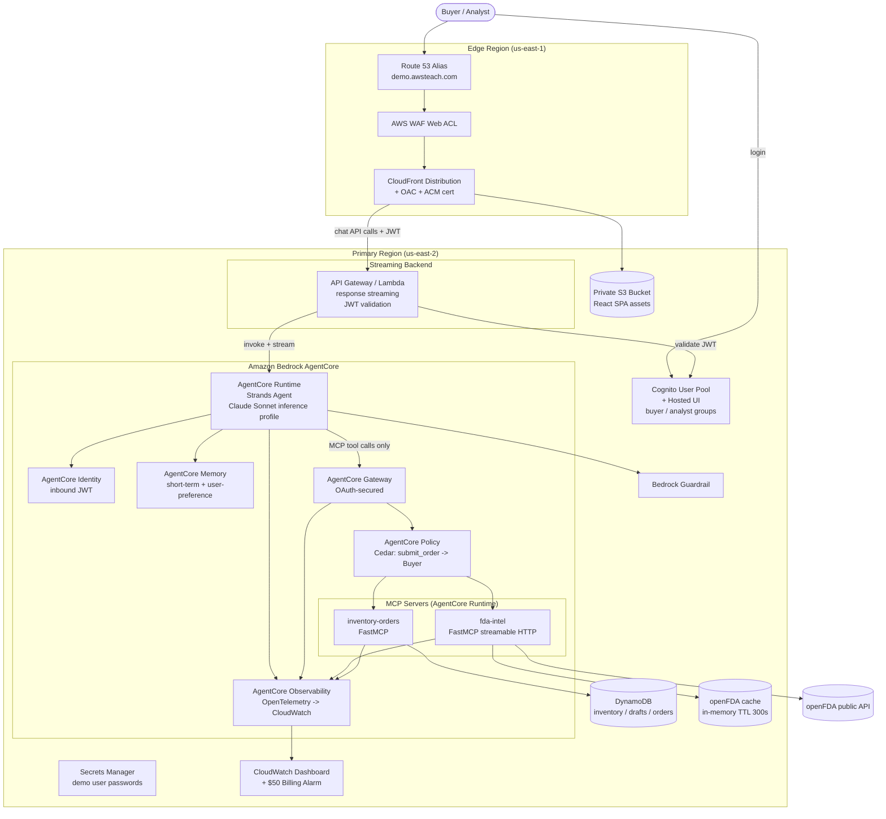
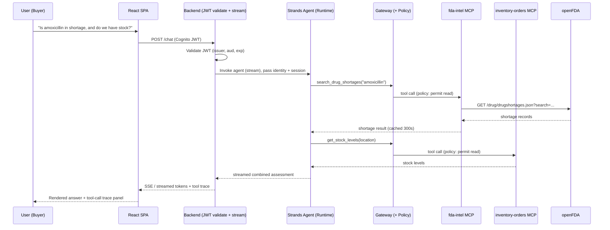

# Design Document: PharmaPulse

## Overview

PharmaPulse is an agentic drug supply and shortage assistant that lets pharmacy buyers and supply-chain analysts chat with an AI agent. The agent checks FDA drug shortages, recalls, and NDC product details (via openFDA), compares them to a simulated pharmacy inventory, suggests therapeutic alternatives, and drafts replenishment orders that require human approval above a configurable threshold.

The system is built on Amazon Bedrock AgentCore and is defined end-to-end with AWS CDK (Python). The agent runs on AgentCore Runtime using Strands Agents with the latest Anthropic Claude Sonnet model reached through a Bedrock inference profile. All tools are exposed as two FastMCP servers and are reachable **only** through an OAuth-secured AgentCore Gateway. A React single-page application provides the chat UI, served over a private S3 + CloudFront (OAC) + WAF distribution behind the custom domain `demo.awsteach.com`. A thin streaming backend validates Cognito JWTs and invokes the agent.

The system uses **only public (openFDA) and synthetic data**. It contains no PHI and no real customer data (Requirement 21).

### Design Goals

- **Correctness and safety for a classroom demo**: deterministic approval gates, role-based tool access, and a content guardrail.
- **Least-privilege, encrypted, tagged infrastructure** that is reproducible and tearable (Requirements 17, 18).
- **Current AgentCore primitives**: Runtime, Gateway, Identity, Memory, Observability, and Policy (Requirement 7, 8, 10, 11, 16).
- **Resilience to external throttling** through caching and exponential backoff against openFDA (Requirement 3).

### Research Summary (informing the design)

Research was conducted against current AWS documentation and the openFDA API. Key findings incorporated into this design:

- **AgentCore Gateway** acts as an MCP-compatible proxy with separate *inbound* and *outbound* authorization. For an MCP server hosted on AgentCore Runtime used as a Gateway target, outbound auth is **No Auth or JWT**, while Runtime inbound auth supports **IAM or JWT**. Inbound auth to the Gateway is a JWT authorizer wired to a trusted issuer (Cognito). Sources: [AgentCore Gateway targets](https://docs.aws.amazon.com/bedrock-agentcore/latest/devguide/gateway-target-MCPservers.html), [Outbound authorization](https://docs.aws.amazon.com/bedrock-agentcore/latest/devguide/gateway-outbound-auth.html).
- **AgentCore Policy** is a deterministic, Cedar-based authorization layer that sits between the Gateway and its tools, with **default-deny** semantics, and supports pattern matching on principal attributes for role-based access control. This is the mechanism used to restrict `submit_order` to the Buyer role. Sources: [Policy permissions](https://docs.aws.amazon.com/bedrock-agentcore/latest/devguide/policy-permissions.html), [Policy scope](https://docs.aws.amazon.com/bedrock-agentcore/latest/devguide/policy-scope.html).
- **AgentCore Memory** stores short-term memory as an append-only event log keyed by `actorId + sessionId`, and long-term memory via configured strategies (semantic, summarization, **user-preference**) extracted asynchronously into namespaces scoped per actor. Sources: [Memory organization](https://docs.aws.amazon.com/bedrock-agentcore/latest/devguide/memory-organization.html), [Strands SDK memory](https://docs.aws.amazon.com/bedrock-agentcore/latest/devguide/strands-sdk-memory.html).
- **AgentCore Observability** emits OpenTelemetry-based traces/metrics to CloudWatch for runtime, gateway, memory, and tool resources. Source: [Observability configure](https://docs.aws.amazon.com/bedrock-agentcore/latest/devguide/observability-configure.html).
- **openFDA** endpoints used: `drug/drugshortages.json` (max `limit` 100), `drug/enforcement.json` (recalls, max `limit` 1000), `drug/ndc.json` (NDC directory), and `drug/label.json` (pharmacologic class / active ingredient for alternatives). Unauthenticated rate limit is 240 requests/min per IP; an API key raises daily limits. Throttling returns HTTP 429. Sources: [openFDA APIs](https://open.fda.gov/apis/), [Authentication / rate limits](https://open.fda.gov/apis/authentication/).

> Content from external sources was rephrased for compliance with licensing restrictions.

---

## Architecture

### High-Level Architecture



### Request Flow (Compare shortage vs. inventory, Requirement 7.4)



### Region Strategy (Requirement 17.6, 17.7)

- **Primary_Region = us-east-2**: Cognito, backend, AgentCore resources, DynamoDB, Secrets Manager, CloudWatch dashboard, billing alarm metric source.
- **Edge_Region = us-east-1**: ACM certificate for CloudFront, the CloudFront distribution, WAF (CLOUDFRONT scope), and Route 53 hosted zone operations. The CloudWatch billing metric (`AWS/Billing EstimatedCharges`) is only published in us-east-1, so the Billing_Alarm is created there.
- Least-privilege IAM, encryption-at-rest, and tagging standards apply uniformly to both regions; only the placement rule is relaxed for edge resources.

---

## Components and Interfaces

### Component Inventory

| Component | Technology | Responsibility | Requirements |
|---|---|---|---|
| Front_End | React SPA | Chat UI, streaming, tool-trace panel, approval dialog, Cognito login/logout | 13 |
| Hosting | S3 (private) + CloudFront OAC + WAF + ACM + Route 53 | Secure content delivery on custom domain | 14 |
| Backend | API Gateway / Lambda (response streaming) | Validate Cognito JWT, invoke agent, stream response | 15 |
| Agent | Strands Agents on AgentCore Runtime | Orchestrate tools via Gateway, memory, guardrail | 7, 8, 9 |
| Gateway | AgentCore Gateway | OAuth-secured MCP proxy; sole tool path | 11 |
| Policy | AgentCore Policy (Cedar) | Restrict submit_order to Buyer | 10 |
| FDA_Intel_Server | Python FastMCP (streamable HTTP) on Runtime | openFDA queries + caching + backoff | 1, 2, 3 |
| Inventory_Orders_Server | Python FastMCP on Runtime | Inventory, drafts, order submission, RBAC | 4, 5, 6, 10 |
| Auth | Cognito user pool + hosted UI | Authentication, roles, demo users | 12 |
| Memory | AgentCore Memory | Short-term session + long-term preferences | 8 |
| Observability | AgentCore Observability + CloudWatch | Traces, dashboard, billing alarm | 16 |
| IaC | AWS CDK (Python) | All infrastructure, tagging, least-privilege | 17 |

### CDK Stack Decomposition (Requirement 17.1)

A single repository with clearly separated stacks. Cross-stack references pass by SSM parameters / stack exports; the edge stacks are explicitly pinned to us-east-1.

```
app.py
stacks/
  foundation_stack.py       # KMS keys, tags aspect, shared IAM boundaries, log groups
  auth_stack.py             # Cognito user pool, hosted UI domain, groups, triggers, demo users, Secrets Manager
  data_stack.py             # DynamoDB tables (inventory, drafts, orders) + seeding custom resource
  mcp_fda_stack.py          # fda-intel MCP server (AgentCore Runtime) + IAM
  mcp_inventory_stack.py    # inventory-orders MCP server (AgentCore Runtime) + IAM + DDB grants
  gateway_stack.py          # AgentCore Gateway, targets (both MCP), Policy engine (Cedar)
  agent_stack.py            # AgentCore Runtime (Strands agent), Identity, Memory, Guardrail, inference profile
  backend_stack.py          # API Gateway / Lambda streaming, JWT authorizer wiring
  edge_cert_stack.py        # (us-east-1) ACM certificate for demo.awsteach.com
  edge_hosting_stack.py     # (us-east-1) S3 origin, CloudFront + OAC, WAF, Route 53 alias
  observability_stack.py    # CloudWatch dashboard; billing alarm (us-east-1)
```

Deployment order: foundation -> auth -> data -> mcp_* -> gateway -> agent -> backend -> edge_cert -> edge_hosting -> observability.

### Interface: FDA_Intel_Server (fda-intel, FastMCP streamable HTTP)

All tools return a structured envelope `{ "status": "OK" | "EMPTY" | "ERROR", "message": str, "data": [...] }` so the agent and tests can reason uniformly.

| Tool | Inputs | Behavior | Requirements |
|---|---|---|---|
| `search_drug_shortages` | `drug_name: str`, `limit?: int<=100` | Query `drug/drugshortages.json`; return shortage records | 1.1, 1.4, 1.5 |
| `get_recalls` | `drug_name: str`, `limit?: int<=100` | Query `drug/enforcement.json`; return recall records | 1.2, 1.4, 1.5 |
| `lookup_ndc` | `ndc: str` | Query `drug/ndc.json`; return product details | 1.3, 1.4, 1.5 |
| `find_therapeutic_alternatives` | `drug_name?: str`, `ndc?: str` | Resolve active ingredient + pharmacologic class via `drug/label.json`/`drug/ndc.json`, then return products sharing either | 2.1, 2.2, 2.3 |

Shared behaviors:
- **Caching**: keyed by `(tool_name, normalized_args)`, TTL 300s. On hit within TTL, return cached value without calling openFDA (3.1); on expired/miss, refresh (3.4, 3.5).
- **Rate-limit/backoff**: on HTTP 429, retry with exponential backoff (base delay, jitter) up to 3 attempts (3.2); on exhaustion, return `status=ERROR` with "openFDA temporarily unavailable" (3.3).
- **Empty vs error**: no matches -> `status=EMPTY` with explanatory message (1.4, 2.3); upstream error -> `status=ERROR` identifying the failed operation (1.5).

### Interface: Inventory_Orders_Server (inventory-orders, FastMCP)

| Tool | Inputs | Behavior | Requirements |
|---|---|---|---|
| `get_stock_levels` | `location_id: str` | Return current quantity per SKU at location; error if unknown location | 4.2, 4.4 |
| `get_low_stock_items` | `location_id: str` | Return SKUs where `quantity < reorder_threshold` | 4.3, 4.4 |
| `create_draft_order` | `location_id: str`, `lines: [{sku_id, quantity}]` | Validate SKUs/quantities, compute total, persist draft, return `draft_id` + `total` | 5.1, 5.2, 5.3, 5.4 |
| `submit_order` | `draft_id: str`, `confirm?: bool` | Role + threshold logic; returns `SUBMITTED` or `PENDING_APPROVAL` | 6.1, 6.2, 6.4, 10.2 |

`submit_order` logic:
1. If caller role is not Buyer -> authorization error (10.2). (Primary enforcement is AgentCore Policy at the Gateway; the server performs defense-in-depth re-check.)
2. Compute total from the draft.
3. If `total <= Approval_Threshold` -> record order `SUBMITTED` (6.1).
4. If `total > Approval_Threshold` and not `confirm` -> `PENDING_APPROVAL`, do not record (6.2).
5. If `total > Approval_Threshold` and `confirm` is true (from approval dialog) -> record `SUBMITTED` (6.4).
6. `Approval_Threshold` is read from configuration, default `$5,000` (6.5).

### Interface: Agent (Strands on AgentCore Runtime)

- Model: latest Claude Sonnet via Bedrock **inference profile** ARN (7.1).
- Tool access: a single MCP client pointed at the **Gateway** endpoint; the agent has no direct network path to the MCP servers or openFDA (7.2, 7.3, 11.3).
- Guardrail: Bedrock Guardrail attached to all model invocations; blocked content yields a safe refusal (9.1, 9.2).
- Memory hooks: write session turns to short-term memory; read/write long-term user-preference namespace keyed by user identity (8.1–8.3).
- Combined assessment: the agent composes FDA + inventory tool results into one answer (7.4).

### Interface: Gateway + Policy

- Inbound authorizer: JWT trusting the Cognito user pool issuer (11.1, 11.2). Missing/invalid credential -> authorization error (11.2).
- Targets: `fda-intel` and `inventory-orders` MCP servers on Runtime (11.1). Outbound auth to Runtime targets uses JWT/No-Auth per Runtime inbound; inbound identity (incl. group claim) is carried for Policy evaluation.
- **Policy (Cedar)**: default-deny. A permit policy allows read tools for authenticated Buyer/Analyst. A permit policy allows `submit_order` only when the principal's group claim is `buyer`. Analyst `submit_order` calls are denied at the Gateway (10.1) and re-rejected by the server (10.2).

### Interface: Backend (streaming)

- `POST /chat`: validates the Cognito JWT (issuer, audience, expiry, signature via JWKS) (15.1, 15.2); on success, invokes the agent on Runtime and streams tokens + tool-trace events back as SSE (15.3).
- Rejects missing/expired/invalid tokens with `401` and a descriptive authorization error (15.2).

### Interface: Front_End (React SPA)

- Streaming chat panel rendering SSE tokens (13.1).
- Tool-call trace panel listing tool invocations per response (13.2).
- Cognito hosted UI login/logout controls (13.3).
- Order approval dialog shown when a `submit_order` response is `PENDING_APPROVAL`; confirmation re-invokes `submit_order` with `confirm=true` (13.4, 6.3).

---

## Data Models

### DynamoDB Tables (Requirement 4, 5, 6; encryption at rest per 17.3)

All tables use on-demand billing, SSE with a customer-managed KMS key, and carry the standard tags.

**1. `pharmapulse-inventory`** — ~200 synthetic SKUs across 3 locations (4.1, 4.5)

| Attribute | Type | Notes |
|---|---|---|
| `PK` (partition) | S | `LOCATION#<location_id>` |
| `SK` (sort) | S | `SKU#<sku_id>` |
| `sku_id` | S | e.g., `SKU-00042` |
| `drug_name` | S | synthetic/public drug name |
| `ndc` | S | NDC identifier (public) |
| `quantity` | N | current stock |
| `reorder_threshold` | N | low-stock boundary |
| `unit_price` | N | price per unit (used for order totals) |
| `location_id` | S | one of 3 fictional locations |

GSI `by-sku` (PK=`sku_id`) for cross-location lookups and SKU existence checks.

**2. `pharmapulse-draft-orders`** (5.1, 5.2)

| Attribute | Type | Notes |
|---|---|---|
| `PK` | S | `DRAFT#<draft_id>` |
| `draft_id` | S | ULID |
| `location_id` | S | target location |
| `lines` | L | list of `{sku_id, quantity, unit_price, line_total}` |
| `total` | N | computed order total |
| `created_by` | S | user identity (actorId) |
| `created_at` | S | ISO-8601 |
| `status` | S | `DRAFT` |

**3. `pharmapulse-orders`** (submitted) (6.1, 6.4)

| Attribute | Type | Notes |
|---|---|---|
| `PK` | S | `ORDER#<order_id>` |
| `order_id` | S | ULID |
| `draft_id` | S | source draft |
| `location_id` | S | target location |
| `lines` | L | frozen snapshot of order lines |
| `total` | N | order total |
| `status` | S | `SUBMITTED` |
| `submitted_by` | S | Buyer identity |
| `submitted_at` | S | ISO-8601 |

> `PENDING_APPROVAL` is a **transient response state**, never persisted (6.2). Only `SUBMITTED` orders are written to `pharmapulse-orders`.

### openFDA Cache Model (Requirement 3)

In-process TTL cache local to the fda-intel server:

```
CacheEntry {
  key: str            # hash(tool_name + normalized_args)
  value: ToolEnvelope # the structured result
  expires_at: float   # epoch seconds = stored_at + 300
}
```

Lookup returns the value iff `now < expires_at`; otherwise the entry is treated as a miss and refreshed.

### AgentCore Memory Model (Requirement 8)

- **Short-term**: append-only event log keyed by `actorId` (Cognito `sub`) + `sessionId` (per chat session) — retains conversation context within the active session (8.1).
- **Long-term**: `USER_PREFERENCE` strategy extracting preferred location and preferred suppliers into a per-actor namespace, e.g. `/preferences/{actorId}` (8.2). A new session retrieves these on start to pre-load context (8.3).

### Identity & Role Model (Requirement 10, 12)

- Cognito groups `buyer` and `analyst`; group claim is carried in the JWT and surfaced to Gateway Policy and the inventory server.
- Self-registration auto-assigns a group via a Cognito post-confirmation (or pre-token-generation) Lambda trigger so permissions apply immediately (12.9, 12.10).
- Demo users (`demo-buyer`, `demo-analyst`) created at deploy time; generated passwords stored in Secrets Manager; location printed on deploy (12.3–12.6, 20.3).

---

## Correctness Properties

*A property is a characteristic or behavior that should hold true across all valid executions of a system — essentially, a formal statement about what the system should do. Properties serve as the bridge between human-readable specifications and machine-verifiable correctness guarantees.*

These properties apply to the **MCP tool logic** (fda-intel and inventory-orders) and the **backend JWT validator**, which are pure or mockable functions with large input spaces. Infrastructure, Cognito/Gateway/Policy enforcement, AgentCore Memory/Observability, Guardrails, and UI are covered by smoke, integration, and example tests (see Testing Strategy) rather than property-based testing.

The following properties were derived from the prework analysis after redundancy elimination.

### Property 1: Upstream records are preserved

*For any* FDA lookup tool (`search_drug_shortages`, `get_recalls`, `lookup_ndc`) and any set of records returned by a mocked openFDA client, the tool SHALL return an envelope with `status=OK` whose `data` contains exactly those records.

**Validates: Requirements 1.1, 1.2, 1.3**

### Property 2: Empty upstream result maps to EMPTY

*For any* FDA lookup tool and any query for which the mocked openFDA client returns zero records, the tool SHALL return an envelope with `status=EMPTY`, empty `data`, and a non-empty "no records found" message.

**Validates: Requirements 1.4, 2.3**

### Property 3: Upstream error maps to descriptive ERROR

*For any* FDA lookup tool and any upstream error condition from the mocked openFDA client, the tool SHALL return an envelope with `status=ERROR` whose message identifies the failed operation.

**Validates: Requirements 1.5**

### Property 4: Alternatives share ingredient or class

*For any* drug input (name or NDC) and any mocked drug catalog, every product returned by `find_therapeutic_alternatives` SHALL share the input drug's active ingredient or its pharmacologic class.

**Validates: Requirements 2.1, 2.2**

### Property 5: Caching honors the 300s TTL

*For any* tool and argument set, two identical calls made within 300 seconds SHALL issue exactly one openFDA request and return equal results; an identical call made at or after 300 seconds SHALL issue a new openFDA request and refresh the cached value.

**Validates: Requirements 3.1, 3.4, 3.5**

### Property 6: Backoff is bounded to 3 attempts

*For any* sequence of simulated openFDA responses, if a success occurs within the first 3 attempts the tool SHALL return that success using at most 3 attempts; if all 3 attempts return HTTP 429 the tool SHALL make exactly 3 attempts and return `status=ERROR` with a "temporarily unavailable" message.

**Validates: Requirements 3.2, 3.3**

### Property 7: Stock levels are complete

*For any* inventory state at a valid location, `get_stock_levels` SHALL return exactly one entry per stored SKU at that location, each reporting the stored quantity.

**Validates: Requirements 4.2**

### Property 8: Low-stock detection is exact

*For any* inventory state at a valid location, `get_low_stock_items` SHALL return exactly the set of SKUs whose current quantity is strictly below that SKU's reorder threshold — no more and no fewer.

**Validates: Requirements 4.3**

### Property 9: Unknown location is rejected

*For any* location identifier not present in inventory, both `get_stock_levels` and `get_low_stock_items` SHALL return an error whose message contains the unknown location identifier.

**Validates: Requirements 4.4**

### Property 10: Draft total equals the sum of line totals

*For any* valid draft order request, the returned `total` SHALL equal the sum over all lines of `quantity * unit_price`.

**Validates: Requirements 5.2**

### Property 11: Draft creation round-trips

*For any* valid draft order request, creating the draft and then fetching it by the returned `draft_id` SHALL yield the same lines and quantities.

**Validates: Requirements 5.1**

### Property 12: Invalid draft input is rejected and not persisted

*For any* draft order request containing at least one unknown SKU or at least one non-positive quantity, `create_draft_order` SHALL return an error identifying the offending SKU or quantity, and SHALL NOT persist a draft.

**Validates: Requirements 5.3, 5.4**

### Property 13: Threshold and confirmation determine submission

*For any* draft order total and confirmation flag, when a Buyer submits, the result SHALL be `SUBMITTED` if and only if the total is at or below the Approval_Threshold OR the confirmation flag is set; otherwise the result SHALL be `PENDING_APPROVAL`. An order SHALL be persisted if and only if the result is `SUBMITTED`.

**Validates: Requirements 6.1, 6.2, 6.4, 6.5**

### Property 14: Server-side role authorization

*For any* caller role and draft, `submit_order` SHALL succeed only when the role is Buyer; when the role is not Buyer the server SHALL return an authorization error and persist no order. All read tools SHALL be permitted for both Buyer and Analyst roles.

**Validates: Requirements 10.2, 10.3, 10.4**

### Property 15: JWT validation is exact

*For any* presented token, the backend validator SHALL accept the request if and only if the token's signature is valid against the Cognito JWKS, the token is unexpired, and the audience matches; otherwise it SHALL reject with an authorization error.

**Validates: Requirements 15.1, 15.2**

---

## Error Handling

### openFDA / FDA_Intel_Server

| Condition | Handling | Requirement |
|---|---|---|
| No matching records | Return `status=EMPTY` with explanatory message, empty data | 1.4, 2.3 |
| Upstream non-429 error (4xx/5xx, network, parse) | Return `status=ERROR` identifying the operation; log with trace id | 1.5 |
| HTTP 429 rate limit | Exponential backoff with jitter, max 3 attempts | 3.2 |
| Retries exhausted | Return `status=ERROR` "openFDA temporarily unavailable" | 3.3 |
| Cache corruption/miss | Treat as miss; fetch fresh | 3.5 |

### Inventory_Orders_Server

| Condition | Handling | Requirement |
|---|---|---|
| Unknown location | Error naming the location; no partial data | 4.4 |
| Unknown SKU in draft | Error naming the SKU; no draft persisted | 5.3 |
| Non-positive quantity | Error naming the invalid quantity; no draft persisted | 5.4 |
| Over-threshold submit without confirm | `PENDING_APPROVAL`; nothing persisted | 6.2 |
| Non-Buyer submit | Authorization error; nothing persisted | 10.2 |
| DynamoDB conditional failure / contention | Retry with jitter; surface a clear tool error on exhaustion | 5.x, 6.x |

### Gateway / Policy / Identity

| Condition | Handling | Requirement |
|---|---|---|
| Missing/invalid OAuth credential at Gateway | Reject with authorization error | 11.2 |
| Policy default-deny (no matching permit) | Tool invocation denied | 10.1 |
| Analyst submit_order | Denied at Gateway (Policy) and re-rejected at server | 10.1, 10.2 |

### Backend / Agent / Guardrail

| Condition | Handling | Requirement |
|---|---|---|
| Missing/expired/invalid JWT | `401` authorization error; no agent invocation | 15.2 |
| Guardrail violation (input or output) | Block content; return safe refusal | 9.2 |
| Agent/tool/stream failure | Emit error event on the stream; surface a user-facing error in the UI; record trace | 15.3, 16.1 |

### Operational (Deploy / Teardown)

| Condition | Handling | Requirement |
|---|---|---|
| Prerequisite unmet or approval absent | Do not deploy; report the gate that failed | 19.4, 19.5 |
| Teardown fails to delete a non-hosted-zone resource | Abort teardown and report the failure | 18.5 |

---

## Testing Strategy

### Dual Approach

- **Unit tests** cover specific examples, edge cases, and error conditions for the MCP tools and the JWT validator.
- **Property-based tests** cover the 15 universal properties above across large generated input spaces.
- **Smoke tests** verify one-time configuration (seed volume, model wiring, dashboards, alarms, IaC assertions).
- **Integration tests** verify managed-service behavior (Gateway/Policy enforcement, Memory, Observability, Guardrail, streaming end-to-end) with 1–3 representative examples.

These are complementary: unit and property tests catch logic bugs cheaply with mocks; integration tests confirm the managed AWS wiring.

### Property-Based Testing (Requirement 18.1)

- Library: **Hypothesis** (Python), the standard PBT library for the Python MCP servers and backend. PBT will not be implemented from scratch.
- Each property test runs a **minimum of 100 iterations** (`@settings(max_examples=100)` or higher).
- External dependencies are mocked: openFDA is a counting HTTP mock; time is a controllable fake clock for TTL/backoff; DynamoDB uses a local/in-memory table (e.g., `moto`) so iterations stay cheap.
- Each property test is tagged with a comment referencing its design property, format:
  `# Feature: pharmapulse, Property {number}: {property_text}`

| Property | Target module | Generators / mocks |
|---|---|---|
| P1 record-preservation | fda-intel tools | random record lists; mocked openFDA client |
| P2 empty-result | fda-intel tools | zero-record responses |
| P3 upstream-error | fda-intel tools | varied raised errors |
| P4 alternatives-membership | find_therapeutic_alternatives | random drug catalogs (ingredient/class) |
| P5 caching-TTL | fda-intel cache | counting mock + fake clock |
| P6 bounded-backoff | fda-intel retry logic | 429 sequences + fake clock |
| P7 stock-completeness | get_stock_levels | random local inventory |
| P8 low-stock-filter | get_low_stock_items | random quantity/threshold pairs |
| P9 unknown-location | inventory reads | absent location ids |
| P10 draft-total | create_draft_order | valid lines |
| P11 draft-roundtrip | create_draft_order | valid line sets |
| P12 invalid-draft-rejected | create_draft_order | unknown SKUs / non-positive qty |
| P13 threshold-confirm | submit_order | totals around threshold + confirm flag |
| P14 role-authorization | submit_order / reads | buyer/analyst roles |
| P15 jwt-validation | backend validator | tokens varying signature/expiry/audience |

The P-numbers in this table correspond directly to the numbered property sections above (for example, P10 is the draft-total property, P11 is the round-trip property, and P12 is the invalid-input rejection property).

### Unit Tests (Requirement 18.1)

- fda-intel: envelope shape, query construction per endpoint, limit clamping (100 for shortages, bounds for enforcement), NDC normalization.
- inventory-orders: default threshold = `$5,000` (6.5), draft line snapshotting, order id generation.
- Backend: JWKS fetch/caching, 401 payload shape.

### Integration Tests

- Gateway inbound auth rejects missing/invalid token (11.2); Policy denies analyst `submit_order` (10.1).
- AgentCore Memory: write session turns and retrieve them (8.1); persist and retrieve a user preference across sessions (8.2, 8.3).
- Guardrail blocks a known-violating prompt (9.2).
- End-to-end streaming: valid JWT yields a streamed agent response invoking both tool families for a comparison prompt (7.4, 15.3).
- Observability: traces/spans appear for agent, gateway, and both MCP servers after an invocation (16.1).

### Smoke Tests (Requirement 18.2)

- Seed check: ~200 SKUs across exactly 3 locations (4.1), synthetic sources only (4.5, 21).
- Model wiring: agent configured with the Claude Sonnet inference profile (7.1); Guardrail attached (9.1).
- CDK assertions: S3 bucket not public + OAC (14.1, 14.2), WAF attached (14.3), ACM cert in us-east-1 (14.4), Route 53 alias to CloudFront (14.5), encryption at rest on all stores (17.3), tags `Project=PharmaPulse` / `Owner=Instructor` present (17.5), region placement (17.6), Cognito password policy and no MFA/email confirmation (12.7, 12.8), CloudWatch dashboard (16.2), $50 billing alarm in us-east-1 (16.3).
- Deployed smoke script exercises `/chat` and prints the final URL and Secrets Manager location (18.2, 20.2, 20.3).

### Front-End Tests (Requirement 13)

- Component tests: streaming render (13.1), tool-call trace panel (13.2), login/logout controls (13.3), approval dialog appears on `PENDING_APPROVAL` and re-submits with `confirm=true` (13.4, 6.3).

### Operational Tests (Requirement 18.4, 18.5, 19)

- Teardown removes all resources except the Hosted_Zone; a simulated delete failure aborts and reports (18.4, 18.5).
- Pre-deployment gate script returns a non-deploy status when approval is absent or prerequisites (model access, hosted zone) are unmet (19.2, 19.3, 19.4, 19.5).

---

## Design Decisions and Rationale

- **Policy for RBAC plus server re-check**: AgentCore Policy (Cedar, default-deny) is the authoritative gate for `submit_order` at the Gateway (10.1); the inventory server repeats the role check for defense-in-depth and so the behavior is unit/property-testable without the managed service (10.2).
- **PENDING_APPROVAL is never persisted**: keeping it a transient response state makes the human-in-the-loop gate unambiguous and keeps the orders table a record of committed purchases only (6.2).
- **In-process TTL cache on fda-intel**: openFDA data changes slowly (shortages/recalls updated at most daily/weekly) so a 300s in-memory cache is sufficient and avoids extra infrastructure, while directly satisfying the caching and backoff requirements (3.x).
- **Edge resources in us-east-1**: CloudFront requires its ACM certificate and the billing metric in us-east-1; all other resources stay in us-east-2 while keeping identical security/tagging standards (17.6, 17.7).
- **Structured tool envelope**: a uniform `{status, message, data}` envelope lets the agent reason about empty/error cases and makes properties (P1–P3) straightforward to express and test.

## Pre-Deployment Verification Gates (Requirement 19)

Executed before any resource is created; deployment is blocked until all pass and the instructor approves:

1. Consult current Amazon Bedrock AgentCore documentation (Runtime, Gateway, Identity, Memory, Observability, Policy) (19.1).
2. Verify Bedrock model access for the target Claude Sonnet model is enabled (19.2).
3. Confirm the Route 53 public hosted zone `awsteach.com` exists (19.3).
4. Present a short architecture plan and wait for explicit instructor approval (19.4); do not deploy without it (19.5).
