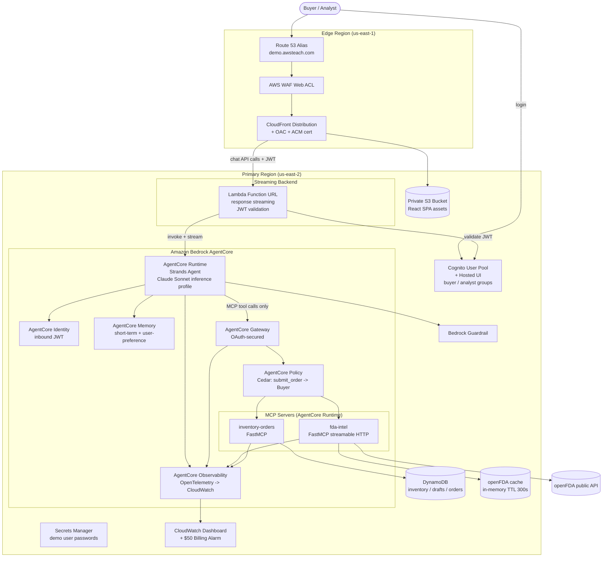

# PharmaPulse

PharmaPulse is an enterprise-grade, agentic drug supply and shortage assistant
for pharmacy buyers and supply-chain analysts. Users chat with an AI agent that
checks FDA drug shortages, recalls, and NDC product details, compares them
against a simulated pharmacy's inventory, suggests therapeutic alternatives, and
drafts replenishment orders that require human approval above a configurable
threshold.

The system is deployed to AWS using Amazon Bedrock AgentCore (Runtime, Gateway,
Identity, Memory, Observability, and Policy) and is defined end-to-end with AWS
CDK (Python). The agent is built with [Strands Agents](https://strandsagents.com)
and uses the latest Anthropic Claude Sonnet model in Bedrock via an inference
profile. Tools are exposed through two FastMCP servers and reached exclusively
through an OAuth-secured AgentCore Gateway. A React single-page application
provides the chat experience, backed by a thin streaming backend that validates
Cognito JWTs.

> **Data compliance:** PharmaPulse uses **only public (openFDA) and synthetic
> data**. It contains **no Protected Health Information (PHI)** and **no real
> customer data**. See [Data compliance](#data-compliance).

The deployed demo lives at **https://demo.awsteach.com**.

## Architecture



Key design points:

- **Two regions.** Everything lives in the primary region **us-east-2** except
  the resources that must live in **us-east-1**: the ACM certificate for
  CloudFront, the CloudFront distribution, the CLOUDFRONT-scope WAF, Route 53,
  and the `$50` billing alarm (the `AWS/Billing` metric is only published in
  us-east-1).
- **Gateway is the sole tool path.** The agent never talks to the MCP servers or
  openFDA directly. It reaches both FastMCP servers only through the
  OAuth-secured AgentCore Gateway, where a Cedar default-deny Policy gates
  `submit_order` to the `buyer` group.
- **Human-in-the-loop.** Orders at or below the `$5,000` approval threshold are
  submitted immediately; orders above it return `PENDING_APPROVAL` and are never
  persisted until the buyer explicitly confirms.
- **Least-privilege, encrypted, tagged.** All data stores use customer-managed
  KMS encryption at rest; every taggable resource carries `Project=PharmaPulse`
  and `Owner=Instructor`; each IAM role gets only the permissions it needs.

## Repository layout

```
app.py                      # CDK app entry point: region strategy, tagging, stack wiring + order
cdk.json                    # CDK app configuration
pyproject.toml              # Project metadata, dependencies, pytest config / markers
requirements.txt            # Runtime dependencies
requirements-dev.txt        # Test / dev dependencies

shared/                     # Shared code
  envelope.py               #   {status: OK|EMPTY|ERROR, message, data} tool envelope helper

stacks/                     # CDK stacks (one module per stack) + shared config
  config.py                 #   regions, tags, table names, approval threshold, domain
  foundation_stack.py       #   KMS keys, global tagging aspect, IAM boundary, log groups
  auth_stack.py             #   Cognito user pool + hosted UI, buyer/analyst groups, demo users
  data_stack.py             #   DynamoDB tables (inventory + by-sku GSI, drafts, orders) + seeding
  mcp_fda_stack.py          #   fda-intel MCP server on AgentCore Runtime
  mcp_inventory_stack.py    #   inventory-orders MCP server on AgentCore Runtime + DDB grants
  gateway_stack.py          #   AgentCore Gateway (JWT inbound) + MCP targets + Cedar Policy
  agent_stack.py            #   AgentCore Runtime (Strands agent), Identity, Memory, Guardrail
  backend_stack.py          #   Streaming Lambda Function URL + JWT validation
  edge_cert_stack.py        #   (us-east-1) ACM certificate for demo.awsteach.com
  edge_hosting_stack.py     #   (us-east-1) S3 origin, CloudFront + OAC, WAF, Route 53 alias
  observability_stack.py    #   CloudWatch dashboard; $50 billing alarm (us-east-1)

servers/
  fda_intel/                # fda-intel MCP server: openFDA client, TTL cache, backoff, tools
  inventory_orders/         # inventory-orders MCP server: inventory, drafts, submit/RBAC

agent/                      # Strands agent application (app.py), gateway client, memory hooks, assessment
backend/                   # Streaming backend handler + Cognito JWT validator
frontend/                   # React SPA (Vite + TypeScript): chat, tool-trace panel, approval dialog
scripts/                    # Operational scripts (predeploy gate, deploy report, smoke test, teardown)
tests/
  unit/                     # Fast unit tests
  property/                 # Hypothesis property-based tests (15 correctness properties)
  smoke/                    # Smoke tests against deployed resources
  integration/              # Integration tests against managed AWS services
```

## Deploy guide

### Prerequisites

1. **An AWS account** with credentials configured (`aws configure` or an SSO
   profile) for the target account.
2. **Node.js + the AWS CDK toolkit** (`npm install -g aws-cdk`) and **Python
   3.12+**.
3. **A bootstrapped CDK environment** in both regions used by the app:

   ```bash
   cdk bootstrap aws://<ACCOUNT_ID>/us-east-2
   cdk bootstrap aws://<ACCOUNT_ID>/us-east-1
   ```

4. **Bedrock model access** for the target Claude Sonnet model enabled in
   us-east-2 (Bedrock console → *Model access*).
5. **The `awsteach.com` Route 53 public hosted zone** must already exist in the
   account; the edge stacks create the `demo.awsteach.com` alias inside it.

### 1. Install dependencies

```bash
python3 -m venv .venv
source .venv/bin/activate
pip install -r requirements-dev.txt
npm --prefix frontend install
```

### 2. Run the pre-deploy gate

The gate confirms prerequisites (Claude Sonnet model access, the `awsteach.com`
hosted zone) and requires explicit approval of the architecture plan before any
resources are created. It returns a non-deploy status unless every check passes
and the plan is approved.

```bash
python scripts/predeploy_gate.py
```

Do not proceed unless the gate reports success.

### 3. Build the frontend

The SPA is built to `frontend/dist`, which the hosting stack uploads to the
private S3 origin.

```bash
npm --prefix frontend run build
```

### 4. Deploy the stacks

Deploy in dependency order. The simplest path is to let CDK resolve the order:

```bash
cdk deploy --all --require-approval never
```

If deploying individually, follow this order (matches `app.py`):

```
PharmaPulse-Foundation
PharmaPulse-Auth
PharmaPulse-Data
PharmaPulse-McpFda
PharmaPulse-McpInventory
PharmaPulse-Gateway
PharmaPulse-Agent
PharmaPulse-Backend
PharmaPulse-EdgeCert        # us-east-1
PharmaPulse-EdgeHosting     # us-east-1
PharmaPulse-Observability
PharmaPulse-BillingAlarm    # us-east-1
```

### 5. Post-deploy reporting

After deployment completes, print the access details — the final URL and the
Secrets Manager location of the demo credentials:

```bash
python scripts/deploy_report.py
```

Expected output:

- **Final URL:** https://demo.awsteach.com
- **Demo credentials:** the AWS Secrets Manager secret holding the generated
  `demo-buyer` and `demo-analyst` passwords (the report prints the exact secret
  name/ARN).

### 6. Smoke test

Verify the live deployment: the `/chat` endpoint responds, inventory holds
~200 SKUs across exactly 3 locations with synthetic-only sources, and the agent
is wired to the Claude Sonnet inference profile with the Guardrail attached.

```bash
python scripts/smoke_test.py
```

### 7. Teardown

Remove every deployed resource **except the `awsteach.com` hosted zone**. If any
non-hosted-zone resource fails to delete, the script aborts and reports the
failure.

```bash
python scripts/teardown.py
```

## Running the tests

### Python (backend, MCP servers, CDK, operational scripts)

```bash
pytest                 # all tests
pytest -m unit         # unit tests only
pytest -m property     # Hypothesis property-based tests only (15 correctness properties)
pytest -m smoke        # smoke tests (require a live deployment)
pytest -m integration  # integration tests (require live AWS resources)
```

Property tests use [Hypothesis](https://hypothesis.readthedocs.io) with a
minimum of 100 iterations and mock all external dependencies (a counting openFDA
mock, a fake clock for TTL/backoff, and `moto`/in-memory DynamoDB), so they run
cheaply without touching AWS.

### Frontend (React SPA)

```bash
npm --prefix frontend test        # component tests (Vitest)
npm --prefix frontend run typecheck
```

## 10-minute classroom demo script

This script walks through the system end to end. Open https://demo.awsteach.com,
log in via the Cognito hosted UI, and paste the prompts into the chat. Watch the
**tool-call trace panel** to show exactly which MCP tools the agent invokes for
each answer.

**Demo users** (passwords are in Secrets Manager — retrieve them with
`python scripts/deploy_report.py`):

- `demo-buyer` — Buyer role: read everything **and** submit orders.
- `demo-analyst` — Analyst role: read-only; `submit_order` is denied.

### Part 1 — FDA intelligence (~3 min, as `demo-buyer`)

Exercises `search_drug_shortages`, `get_recalls`, `lookup_ndc`, and
`find_therapeutic_alternatives` on the fda-intel server.

1. *"Is amoxicillin currently in shortage according to the FDA?"*
   → shortage lookup; point out the live openFDA data in the trace.
2. *"Are there any recent recalls for lisinopril?"*
   → recall (enforcement) lookup.
3. *"Look up the product details for NDC 0069-2587."*
   → NDC directory lookup. (Try a made-up NDC to show the clean "no records
   found" EMPTY response.)
4. *"What therapeutic alternatives are there for atorvastatin?"*
   → alternatives sharing the active ingredient or pharmacologic class.

### Part 2 — Inventory and the combined assessment (~3 min, as `demo-buyer`)

Exercises `get_stock_levels`, `get_low_stock_items`, and the agent's combined
FDA-vs-inventory assessment.

5. *"Show me the stock levels at location LOC-1."*
   → inventory read across the synthetic SKUs at that location.
6. *"Which items are low on stock at LOC-1?"*
   → low-stock detection (quantity below reorder threshold).
7. *"Is amoxicillin in shortage, and do we have enough stock of it on hand?"*
   → the headline moment: the agent calls **both** the FDA shortage tool **and**
   the inventory tool, then returns one combined supply-risk assessment. Show
   both tool calls in the trace.

### Part 3 — Drafting and the human-in-the-loop approval (~3 min, as `demo-buyer`)

Exercises `create_draft_order` and `submit_order`, including the over-threshold
`PENDING_APPROVAL` flow.

8. *"Draft an order for 50 units of the low-stock items at LOC-1."*
   → a draft order is created; note the returned draft id and total.
9. *"Submit that order."*
   - If the total is **at or below $5,000**, it returns `SUBMITTED` immediately.
   - If the total is **above $5,000**, it returns `PENDING_APPROVAL` and the
     front-end pops the **order approval dialog**. Nothing is persisted yet.
   To guarantee the over-threshold path on stage, draft a larger order first,
   e.g. *"Draft an order for 2,000 units of SKU-00001 at LOC-1, then submit
   it."*
10. **Confirm in the approval dialog.** → the SPA re-invokes `submit_order` with
    `confirm=true` and the order flips to `SUBMITTED`. This is the
    human-in-the-loop control: high-value purchases never commit without an
    explicit human click.

### Part 4 — Role-based access control (~1 min)

Log out and log back in as **`demo-analyst`**, then repeat a read and an order
submission:

11. *"Which items are low on stock at LOC-1?"* → **works** — analysts can read
    shortage, recall, NDC, inventory, and alternative data.
12. *"Draft an order for 10 units of SKU-00001 at LOC-1 and submit it."* → the
    draft is created, but **`submit_order` is denied with an authorization
    error**. The Cedar Policy at the Gateway blocks it for the `analyst` group,
    and the inventory server re-rejects it as defense in depth.

Switching back to `demo-buyer` and submitting the same order succeeds — a clean
side-by-side of the buyer-vs-analyst RBAC difference.

## Data compliance

PharmaPulse uses **only** two data sources:

- **openFDA** — the public U.S. FDA open data API (drug shortages, recalls, the
  NDC directory, and drug labels).
- **Synthetic inventory** — ~200 fabricated SKUs across 3 fictional pharmacy
  locations, generated at deploy time.

There is **no Protected Health Information (PHI)** and **no real customer data**
anywhere in the system — stored or processed. This keeps the demo free of
privacy and compliance risk.

## The shared tool envelope

Every MCP tool returns a uniform structured envelope so the agent and the tests
can reason about results consistently:

```python
from shared import ok, empty, error

ok([{"ndc": "0001-0001"}], message="1 product found")
empty("no shortage records found for amoxicillin")
error("search_drug_shortages failed: openFDA temporarily unavailable")
```

- `OK`    — succeeded; `data` holds result records.
- `EMPTY` — succeeded but matched nothing; `data` is `[]`.
- `ERROR` — failed; `message` identifies the failed operation.
